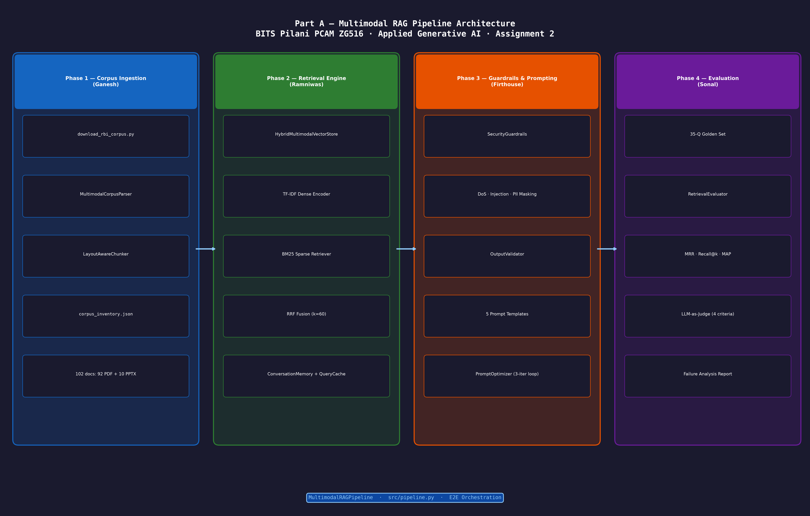

# RBI Multimodal Retrieval System

Group project for **PCAM* ZG516 - Applied Generative AI, Assignment 2**. The project explores a retrieval-augmented workflow for finding evidence in Reserve Bank of India (RBI) regulatory documents and answering questions with document and page/slide references.



## Project workflow

The Part A system is organized into four phases:

1. **Corpus ingestion** - Download and assemble the RBI document collection, maintain its inventory, and provide parsed text, tables, and image descriptions.
2. **Retrieval engine** - Retrieve relevant parsed elements with hybrid TF-IDF/BM25 ranking, metadata filters, reranking, and short-term query memory.
3. **Guardrails and prompting** - Apply input checks and run prompt variants and prompt-optimization experiments.
4. **Evaluation** - Evaluate retrieval against a curated golden set and produce benchmark reports.

This repository currently contains the ingestion assets, the Phase 2 retrieval engine, and Phase 3 guardrail/prompting experiments. It does not contain a complete user-facing chatbot or a live LLM answer-generation service.

## Repository layout

| Path | Purpose |
| --- | --- |
| `data/corpus/` | RBI regulatory PDFs and supplementary PowerPoint briefing decks |
| `data/parsed_elements.json` | Extracted text, table contents, and image descriptions with source metadata |
| `data/corpus_inventory.csv`, `data/corpus_inventory.json` | Corpus inventory and document metadata |
| `data/golden_set.json` | Curated questions, expected answers, modalities, and source locations |
| `data/ontology.yaml` | Domain metadata and prompt-routing rules |
| `download_rbi_corpus.py` | Corpus download and briefing-deck generation script |
| `phase2/` | Hybrid retrieval engine, API, tests, and Phase 2 documentation |
| `phase3/` | Guardrails, prompt templates, self-improvement loop, and benchmark runner |
| `output/` | Benchmark and report output files |
| `report/` | Architecture diagram and project report resources |

### Corpus source note

The `download_rbi_corpus.py` script downloads regulatory PDFs from an RBI archive dataset and generates 10 supplementary briefing decks and diagrams. The generated decks are useful for project examples and multimodal demonstrations, but they are not original RBI publications. Verify regulatory facts against primary RBI documents before relying on them.

## Data ingestion

The current ingestion script is `download_rbi_corpus.py`. From the repository root, run:

```powershell
python download_rbi_corpus.py
```

It requires network access. The script selects up to 92 PDFs from the configured RBI archive dataset, downloads them into `data/corpus/`, generates 10 supplementary PowerPoint briefing decks and diagrams, and writes `data/corpus_inventory.json` and `data/corpus_inventory.csv`.

**Important scope detail:** the downloader does not parse PDFs or presentations into searchable chunks and does not create `data/parsed_elements.json`. That parsed-elements file is an existing project asset consumed by Phase 2. The parser implementation and a complete reproducible parse/rebuild command are not included in this repository yet. If you regenerate or replace corpus files, update/rebuild the parsed-elements data and inventory together before running retrieval.

The parsed-elements format is a JSON list. Each element contains fields such as `element_id`, `doc_id`, `doc_name`, `category`, `doc_format`, `page_or_slide`, `modality`, `content`, and optional metadata. Phase 2 indexes the element content and selected metadata; image records must contain useful extracted descriptions for text-based retrieval.

## Setup

Run commands from the repository root using Python 3.10 or later.

Install the retrieval engine dependencies:

```powershell
python -m pip install -r phase2/requirements.txt
```

The Phase 2 engine reads the parsed corpus at `data/parsed_elements.json`. The benchmark also reads `data/golden_set.json`.

## Run Phase 2 retrieval

Run the retrieval unit tests:

```powershell
python -m pip install pytest
python -m pytest -q phase2/tests/test_retrieval_engine.py
```

Run the retrieval benchmark against the golden set:

```powershell
python phase2/run_demo.py --top-k 10 --output-dir output
```

The engine can also be called from Python:

```python
from phase2.retrieval_engine import RetrievalEngine

engine = RetrievalEngine()
results = engine.search(
    "What is the statutory headline inflation target?",
    top_k=5,
)

for result in results:
    print(result.citation())
    print(result.content)
```

Optional search filters include `modality` (`text`, `table`, or `image`), `doc_name`, and `category`. Use `engine.format_context(results)` to assemble citation-bearing context for a downstream prompt.

## Run Phase 3 experiments

From the repository root:

```powershell
python phase3/run_benchmark.py
```

Phase 3 contains:

- `phase3/guardrails.py` - request-size/rate checks, prompt-injection detection, finance-domain scope checks, PII masking, and citation/grounding output checks.
- `phase3/prompt_templates.py` - zero-shot, f-string, three-shot, ontology/Jinja2, and CREATE-style prompt renderers.
- `phase3/self_improving_loop.py` - a seeded 70/30 development/held-out split and three prompt variants/iterations.
- `phase3/run_benchmark.py` - runs the guardrail, prompt-ablation, self-improvement, and consistency demonstrations, then writes a summary report.

The runner writes `guardrails_benchmark.csv`, `prompt_ablation_results.csv`, `self_improving_iterations.json`, `self_improving_log.csv`, `consistency_benchmark.csv`, and `phase3_report_summary.md` under the root `output/` directory. The prompt renderer can use `PyYAML` and `Jinja2` when installed; it has fallback behavior if either optional package is unavailable.

**Evaluation caveat:** the Phase 3 benchmark runner currently uses predefined sample responses, heuristic scores, and estimated token/latency values in places; these are not results from live model inference. Treat them as prototype/demo evidence, not as independently measured LLM performance.

## Current Phase 2 benchmark snapshot

The recorded run in `output/phase2_retrieval_metrics.json` evaluates 35 golden-set questions:

| Metric | Recorded result |
| --- | ---: |
| Recall@10 | 94.29% |
| MRR | 0.689 |
| P50 retrieval latency | 101.1 ms |
| P95 retrieval latency | 161.168 ms |

These are retrieval-only measurements from one environment and corpus snapshot. They do not measure answer-generation quality or latency. Rerun the benchmark after corpus or ranking changes.

## Limitations

- The retrieval engine builds its TF-IDF and BM25 indexes in memory at startup; it does not persist an index or use a hosted vector database.
- The repository does not include the parser that produced `data/parsed_elements.json`; re-running the downloader alone is not enough to rebuild the complete retrieval corpus.
- Retrieval of image content depends on captions/descriptions already extracted into `data/parsed_elements.json`; Phase 2 does not perform OCR or image understanding.
- Query memory is in-process and short-term. It is not persistent across application restarts.
- Benchmark scores depend on the curated golden set and should be reviewed alongside per-question results in `output/phase2_retrieval_benchmark.csv`.
- This README documents the implemented Part A prototype; it is not a substitute for the assignment report, design diagrams, contribution statement, demonstration, or the individual Part B deliverables.
